<div align="center">

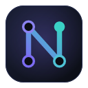

# NEXUS

**Your projects, Claude and your knowledge — connected.**<br />
A local-first desktop workbench for [Claude Code](https://code.claude.com): one workspace for every project, sessions
that start informed, rules Claude actually follows — and a setup that travels to your next computer through your own Git.

<a href="https://github.com/Makogai/nexus/releases/latest"></a>


<br /><br />


</div>

## Download

| Platform | Get it | |
| --- | --- | --- |
| **Windows** 10/11 x64 | [`NEXUS_0.5.0_x64-setup.exe`](https://github.com/Makogai/nexus/releases/latest) | per user, no administrator rights |
| **macOS** 11+ | [Apple silicon `.dmg`](https://github.com/Makogai/nexus/releases/latest) · [Intel `.dmg`](https://github.com/Makogai/nexus/releases/latest) | drag to Applications |
| **Linux** x64 | [`.AppImage`](https://github.com/Makogai/nexus/releases/latest) · [`.deb`](https://github.com/Makogai/nexus/releases/latest) | most distributions |

You need **Claude Code** (signed in) and **Git**. The builds are not code-signed yet — the
[release notes](docs/RELEASE_NOTES.md) show the one-time confirmation on each platform and how to verify a download
(SHA-256 checksums and build-provenance attestations).

## What it does

<table>
  <tr>
    <td width="33%" valign="top">
      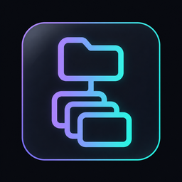<br />
      <b>Workspaces &amp; projects</b><br />
      Group repositories into workspaces. Start one in an empty Git repository; add projects from a folder or straight from Git.
    </td>
    <td width="33%" valign="top">
      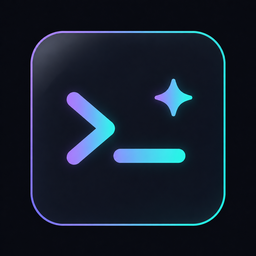<br />
      <b>Claude sessions</b><br />
      Launch Claude Code in the built-in terminal with the right profile, project context and NEXUS tools; resume any session later.
    </td>
    <td width="33%" valign="top">
      <br />
      <b>Learn a project</b><br />
      NEXUS maps a new project itself; a guided Claude session drafts its overview and architecture — you decide what enters the knowledge base.
    </td>
  </tr>
  <tr>
    <td width="33%" valign="top">
      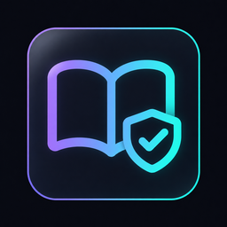<br />
      <b>Knowledge &amp; rules</b><br />
      Tasks, decisions, notes and constitutions as Markdown in your workspace — read formatted, edited in place, synced changes approved by you.
    </td>
    <td width="33%" valign="top">
      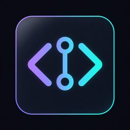<br />
      <b>Files &amp; commits</b><br />
      A read-only code viewer and the history of what was committed, with diffs. Files that may hold secrets are never shown.
    </td>
    <td width="33%" valign="top">
      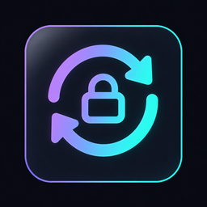<br />
      <b>Portable workspace</b><br />
      Reviewed Git sync — inspected commits, fast-forward pulls, never a force-push — and a guided restore on your next computer.
    </td>
  </tr>
</table>

## A quick tour

**Learn a project** — NEXUS reads the repository itself (files, languages, docs, history), then a guided Claude session
drafts the overview and architecture for you to accept.

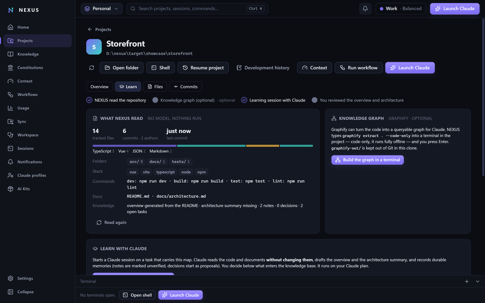

<table>
  <tr>
    <td width="50%" valign="top"><b>Files</b> — read-only explorer with syntax highlighting<br />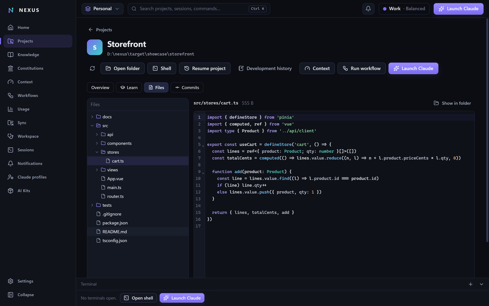</td>
    <td width="50%" valign="top"><b>Commits</b> — changed files, renames and diffs<br />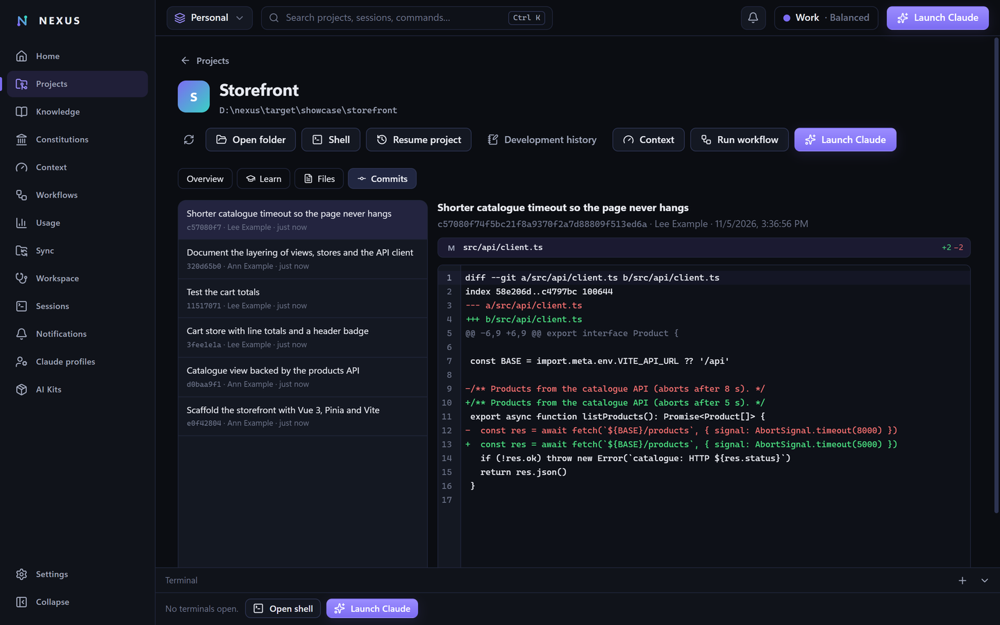</td>
  </tr>
  <tr>
    <td width="50%" valign="top"><b>Rules</b> — constitutions as readable rule cards, editable in place<br />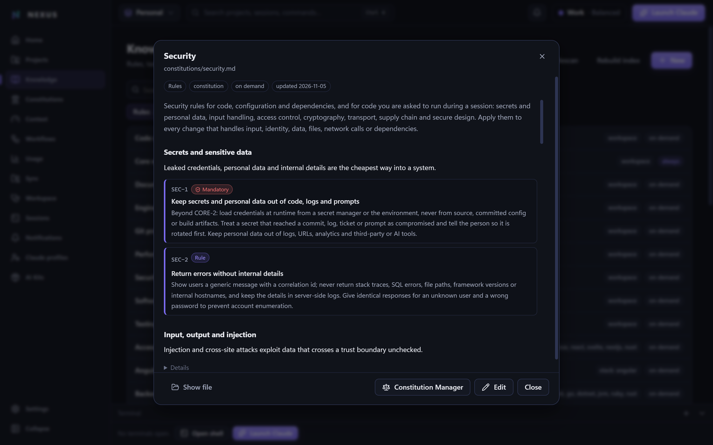</td>
    <td width="50%" valign="top"><b>Constitutions</b> — scoped rules with stable ids, read on demand<br />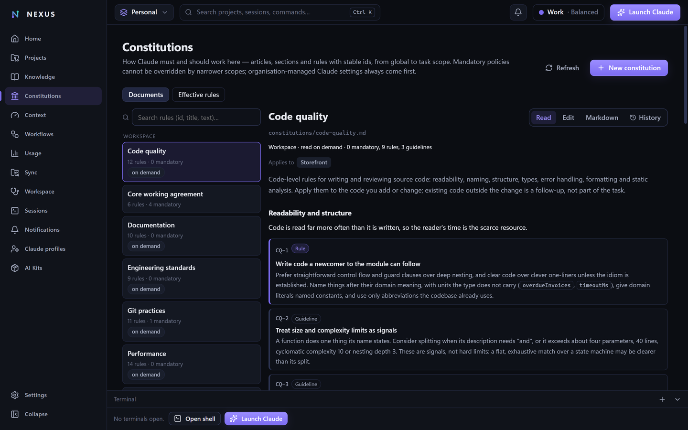</td>
  </tr>
</table>

## How it works

1. **Create your workspace** — point NEXUS at an empty private repository and pick a template. *AI Engineering Pro*
   brings 284 reviewed rules, 11 skills and 7 workflows; only a small core is always in Claude's context.
2. **Add your projects** — from a folder or from Git. Each gets a portable context (overview, architecture, current
   state, environment) that travels with the workspace.
3. **Work with Claude** — learn the project, launch sessions with the right context, run workflows whose quality gates
   you approve, and sync it all through your own Git.

The full walkthrough is in [`docs/user/PORTABLE_WORKSPACE.md`](docs/user/PORTABLE_WORKSPACE.md); every guide lives in
[`docs/user/`](docs/user/).

## Principles

- **Your Claude setup stays yours** — profiles are read, never modified; everything a session gets is session-scoped.
- **Reads your code, never runs it** — repository files are data; commands run only as quality gates you approve.
- **Secrets stay hidden** — credentials are never stored or displayed; every commit and push is inspected first.
- **Git you can trust** — reviewed commits, fast-forward pulls, no force-push, ever.
- **No telemetry** — NEXUS calls no AI model itself and sends nothing anywhere.
- **Your data survives** — daily backups, a backup before every upgrade, a restore that verifies before it replaces.

## Command line

Every desktop feature has a CLI twin, `nexus` (installed next to the app):

```bash
nexus workspaces create ~/workspaces/personal --name Personal --template ai-engineering-pro
nexus projects add https://github.com/you/app.git      # clone into projects/ and register
nexus launch --project app                              # Claude Code with NEXUS's context and tools
nexus workspaces doctor                                 # health of the workspace, with reviewable repairs
nexus sync status                                       # the workspace repository, nothing pushed on its own
```

## Development

NEXUS is a [Tauri 2](https://tauri.app) app: Rust core (`crates/nexus-core`), CLI + MCP server + hooks
(`crates/nexus-cli`), and a Vue 3 desktop (`apps/desktop`).

```bash
cargo test --workspace
cargo clippy --workspace --all-targets -- -D warnings
cd apps/desktop && npm ci && npm test && npm run build
cd apps/desktop && npm run tauri dev                    # NEXUS_DATA_DIR=<empty dir> for an isolated database
```

End-to-end suites drive the real app over the WebView2 DevTools protocol on Windows — see
[`docs/TESTING.md`](docs/TESTING.md). Design decisions are recorded in [`docs/DECISIONS/`](docs/DECISIONS/), the
threat model in [`docs/THREAT_MODEL.md`](docs/THREAT_MODEL.md), and the state of the work in
[`CURRENT_STATE.md`](CURRENT_STATE.md) and [`docs/ROADMAP.md`](docs/ROADMAP.md). The website lives in
[`website/`](website/) and is deployed to GitHub Pages.

## License

Licensed under either of [Apache License, Version 2.0](LICENSE-APACHE) or [MIT license](LICENSE-MIT) at your option.
Third-party components and their licences are listed in [`THIRD_PARTY_NOTICES.md`](THIRD_PARTY_NOTICES.md).

Unless you explicitly state otherwise, any contribution intentionally submitted for inclusion in NEXUS by you, as
defined in the Apache-2.0 license, shall be dual licensed as above, without any additional terms or conditions.
