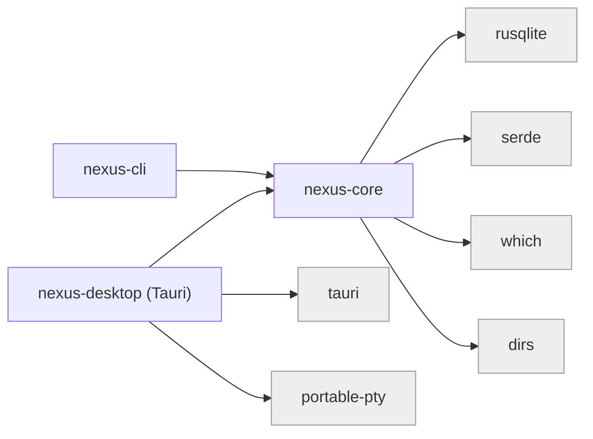
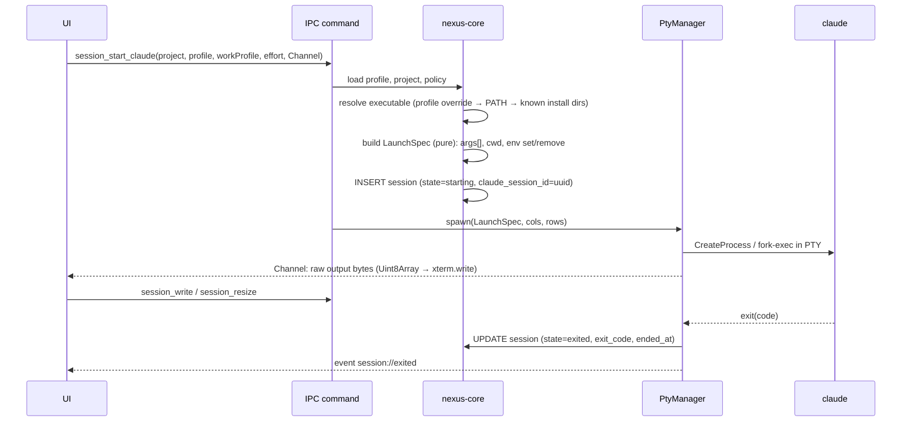

# NEXUS Architecture

Status: living document. Decisions referenced as `ADR-NNNN` live in [`docs/DECISIONS/`](DECISIONS/).

## 1. Shape of the system

NEXUS is a local-first desktop application that **orchestrates** Claude Code; it does not reimplement it.
Claude Code keeps its native interactive terminal experience, its own configuration directories, its own
transcripts and its own permission system. NEXUS adds what Claude Code does not have: a multi-profile,
multi-workspace, multi-project control plane with persistent engineering continuity.

```mermaid
flowchart TB
  subgraph Desktop["apps/desktop — NEXUS Desktop (Tauri 2)"]
    UI["Vue 3 UI<br/>views · stores · xterm.js terminal pool"]
    CMD["IPC command layer<br/>(input validation, DTOs)"]
    PTY["PtyManager<br/>portable-pty · ring buffers · exit watchers"]
    UI -- "invoke / Channel (raw bytes)" --> CMD
    CMD --> PTY
  end

  subgraph Core["crates/nexus-core — shared Rust library"]
    DB["db<br/>SQLite · WAL · migrations"]
    WS["workspace<br/>manifest I/O"]
    PRJ["project<br/>registry · stack detection"]
    GIT["git<br/>git CLI · porcelain v2"]
    CL["claude<br/>install discovery · profiles · policy · auth · launch spec"]
    SES["session · host · checkpoint<br/>records · host leases · reconcile · checkpoints"]
    WP["workprofile<br/>rigor definitions"]
    ENV["env<br/>child-environment hygiene"]
  end

  subgraph CLI["crates/nexus-cli — `nexus` binary"]
    CLIC["CLI commands<br/>doctor · workspaces · projects · profiles · sessions · launch"]
    MCP["`nexus mcp`<br/>stdio MCP server"]
    HOOK["`nexus hook <event>`<br/>exec-form hook handler"]
  end

  CMD --> Core
  CLIC --> Core
  MCP --> Core
  HOOK --> Core

  subgraph Claude["Claude Code (external, per profile)"]
    CC["claude (interactive, in PTY)"]
    CFG[("CLAUDE_CONFIG_DIR<br/>settings · transcripts · plugins")]
    CC --- CFG
  end

  PTY -- "spawn: args[] + scrubbed env<br/>--session-id · --append-system-prompt<br/>(Phase 2: --mcp-config · --plugin-dir · --settings)" --> CC
  CC -- "stdio MCP (Phase 2)" --> MCP
  CC -- "hooks (Phase 2)" --> HOOK

  DB[("nexus.db<br/>(machine-local, %LOCALAPPDATA%\\NEXUS)")]
  WSF[("Workspace dir (Git-friendly)<br/>nexus-workspace.json · knowledge/ · tasks/")]
  REPOS[("Project repos<br/>(independent Git repositories)")]
  Core --> DB
  WS --> WSF
  GIT --> REPOS
```

### Module dependency rules



* `nexus-core` has **no** dependency on Tauri, PTYs or any UI. Everything the CLI, MCP server and hook
  handler need lives here, so behaviour is implemented once (spec §26).
* Inside `nexus-core` the dependency direction is: `env`, `paths`, `error` → `db`, `git`, `workspace` →
  `project`, `claude` → `session`. `claude::launch` is a **pure function** (profile + project + options →
  `LaunchSpec`) so profile-aware launching is unit-testable without spawning anything.
* PTY handling lives in the desktop crate because only the desktop renders terminals. The CLI launches
  `claude` in the user's own terminal (it simply execs).
* We start with **two crates + one app**, not nine. A module graduates to its own crate only when a second
  consumer or a compile-time boundary justifies it (ADR-0001).

## 2. Data ownership (single source of truth per fact)

| Fact | Authority | NEXUS role |
| --- | --- | --- |
| Branch, commits, dirty state, remotes | Git repository | Read via `git` CLI, cache nothing durable |
| Claude settings, plugins, skills, credentials, transcripts | Claude config dir of the profile | Read-only inspection; never edits external profiles (ADR-0004) |
| Organization policy | Managed settings (machine) / server-managed settings (account) | Detected, displayed, obeyed, never overridden |
| Workspace identity + portable project registrations | `nexus-workspace.json` in the workspace dir | Read/write (atomic) |
| Portable knowledge: tasks, decisions, durable memory | Markdown/JSON files in the workspace dir (Phase 3–4) | Authored by NEXUS + humans; SQLite FTS index is rebuildable |
| Machine-local bindings: project → absolute path on *this* machine | SQLite | Authoritative |
| Claude profile registrations (config dir, executable, defaults) | SQLite | Authoritative (profiles are machine-specific) |
| Session records, process records, usage samples, app settings | SQLite | Authoritative |

Rule of thumb: **if it should travel to another machine it is a file in the workspace; if it is about this
machine it is a row in SQLite; if another tool owns it NEXUS only reads it** (ADR-0005).

## 3. Runtime process model

* **NEXUS Desktop** — one process. Owns the SQLite connection used by the UI, the PTY manager and all
  child processes it starts (Claude sessions, shells; later dev servers).
* **Claude sessions** — each is a child process attached to a PTY (ConPTY on Windows). Launched directly
  (no shell string), with an explicit argument vector and a scrubbed environment (ADR-0003).
* **`nexus` CLI** — `nexus launch` runs Claude in the user's own terminal and is a *session host* like the desktop
  (ADR-0014): it registers in `session_hosts`, keeps a 15 s lease, and its sessions become `interrupted` if it dies.
* **`nexus mcp`** — started by Claude from the per-session `--mcp-config`; bound to one NEXUS session; opens the same
  SQLite file (WAL, busy timeout). The desktop notices commits from these processes by polling `PRAGMA data_version`
  (a few-byte read) instead of running a network endpoint (ADR-0009).
* NEXUS exposes **no TCP/HTTP listener**. There is nothing to authenticate against on localhost.

## 4. Claude session launch pipeline



`LaunchSpec` for a profile with an explicit config dir:

```text
program  = <resolved claude executable>
args     = [--session-id <uuid>] | [--resume <uuid>]
           [-n <title>] [--effort <level>] [--model <m>]
           [--append-system-prompt <work-profile fragment>]
           <profile.extra_args…>
cwd      = project local path
env.set  = CLAUDE_CONFIG_DIR=<dir>, NEXUS_SESSION_ID, NEXUS_WORKSPACE_ID, NEXUS_PROJECT_ID, TERM, COLORTERM
env.del  = CLAUDECODE, CLAUDE_CODE_* session vars, CLAUDE_PID, CLAUDE_EFFORT, ANTHROPIC_* (unless profile opts in),
           CLAUDE_CONFIG_DIR (for the *default-location* profile)
```

The **default-location profile** (`~/.claude` + `~/.claude.json`) is launched with `CLAUDE_CONFIG_DIR`
**removed**, never set to `~/.claude`: setting it would move the global state file to
`~/.claude/.claude.json` and silently lose MCP servers, project trust and onboarding state (verified
on this machine; see `docs/RESEARCH.md`).

## 5. Terminal data path

* `portable-pty` reader thread → 64 KiB reads → `tauri::ipc::Channel` raw byte messages → `xterm.write(Uint8Array)`.
  xterm decodes UTF-8 across chunk boundaries, so Rust never splits multibyte sequences.
* Every live PTY keeps a bounded **ring buffer** (default 512 KiB) so a webview reload, view switch or HMR can
  re-attach and replay recent output.
* Input: `term.onData` → `session_write`. Resize: fit addon → `session_resize` (debounced).
* xterm instances live in a terminal pool outside the routed views, so switching views never destroys a
  running Claude TUI.

## 6. Storage layout

```text
<data dir>                          Windows: %LOCALAPPDATA%\NEXUS   macOS: ~/Library/Application Support/NEXUS
├── nexus.db (+ -wal, -shm)         Linux: $XDG_DATA_HOME/NEXUS     override: NEXUS_DATA_DIR
├── logs/                           (rotating, secrets never logged)
└── sessions/<nexus-session-id>/    per-session generated artifacts (Phase 2: mcp.json, settings.json)

<workspace dir>                     chosen by the user, optionally a Git repo
├── nexus-workspace.json            schema_version, id, name, projects[] (portable fields only)
├── README.md
├── .gitignore                      ignores repos/ so project clones are never absorbed
├── repos/                          default location for cloned project repos (independent Git repos)
├── knowledge/                      Phase 3: decisions, project notes, durable memory (Markdown)
└── tasks/                          Phase 4: one Markdown file per task (front-matter + body)
```

## 7. SQLite schema (v1)

```sql
workspaces(id PK, name, description, root_path UNIQUE, created_at, last_opened_at, archived_at)
claude_profiles(id PK, name UNIQUE, description, color, config_dir NULL /*NULL = default location*/,
                executable NULL, extra_args_json, managed_by_nexus, default_work_profile, default_effort,
                default_model, created_at, updated_at, last_used_at, archived_at)
projects(id PK /*same id as manifest*/, workspace_id FK, name, local_path, remote_url, stack_json,
         created_at, last_opened_at)
session_hosts(id PK, kind CHECK(desktop|cli|service), pid, version, started_at, heartbeat_at, stopped_at)  -- v2
session_events(id PK, session_id FK, kind, summary, data JSON, source, created_at)                  -- v3, rebuilt v4
-- v4 session counters: turns, prompts, subagents, last_activity_at, attention, end_reason, transcript_path
sessions(id PK, kind CHECK(claude|shell), host, host_id FK, integrations JSON, workspace_id, project_id NULL, profile_id NULL,
         claude_session_id NULL, title, cwd, branch, work_profile, effort, model, program, pid,
         state CHECK(starting|running|exited|interrupted|failed), exit_code, error,
         resumed_from NULL, started_at, ended_at, archived_at)
app_settings(key PK, value_json)
```

Timestamps are Unix milliseconds (INTEGER). Foreign keys enforced (`PRAGMA foreign_keys=ON`).
Migrations are forward-only SQL scripts applied in a transaction and tracked with `PRAGMA user_version`;
the app refuses to open a database whose version is newer than it understands (ADR-0002).

## 8. IPC surface (desktop)

All commands are `async` Tauri commands returning `Result<T, IpcError>` where `IpcError` is
`{ code, message }` (no stack traces, no secrets). Paths arriving from the UI are validated:
absolute, normalized, existing, no device/UNC namespace tricks (`\\?\`, `\\.\`).

| Area | Commands |
| --- | --- |
| App | `app_info` |
| Workspaces | `workspace_list`, `workspace_create`, `workspace_import`, `workspace_activate`, `workspace_active` |
| Projects | `project_list`, `project_inspect_path`, `project_register`, `project_unregister`, `project_get`, `project_git_status` |
| Claude | `claude_installations`, `profile_list`, `profile_detect`, `profile_register`, `profile_create`, `profile_update`, `profile_archive`, `profile_inspect` |
| Work profiles | `work_profile_list` |
| Sessions | `session_list`, `session_start_claude`, `session_resume`, `session_open_shell`, `session_attach`, `session_write`, `session_resize`, `session_stop`, `session_rename`, `session_archive` |
| Shell | `shell_list` |

Tauri capabilities grant only `core:default`, `dialog:allow-open` (folder picker) and
`opener:allow-open-path`/`allow-reveal-item-in-dir`. There is **no** generic filesystem or shell plugin:
every filesystem/process operation goes through a purpose-built, validated command.

## 9. Claude integration surfaces (by phase)

| Surface | Mechanism | Phase | Degrades when |
| --- | --- | --- | --- |
| Profile isolation | `CLAUDE_CONFIG_DIR` in child env | 1 | — |
| Session identity | NEXUS-assigned `--session-id`, `--resume` | 1 | — |
| Engineering rigor | `--append-system-prompt` (frozen per conversation by the system-prompt snapshot) | 1 | — |
| Native effort/model | `--effort`, `--model` | 1 | — |
| Live session list | `claude agents --json` reconciliation | 2 | older CLI |
| Auth status | `claude auth status --json` (per profile env) | 1 | CLI absent |
| NEXUS tools | `--mcp-config <generated file>` → `nexus mcp --session <id>` (implemented) | 2 ✅ | `disableSideloadFlags`, `allowManagedMcpServersOnly`, `strictPluginOnlyCustomization` |
| Lifecycle capture | `--settings <generated file>` exec-form hooks → `nexus hook` (implemented, additive to user hooks — verified) | 2 ✅ | `allowManagedHooksOnly`, `disableAllHooks` |
| Skills / AI Kits | `--plugin-dir <kit>` per session (no copying into config dirs) | 4–5 | `disableSideloadFlags`, `strictPluginOnlyCustomization` |
| Usage | OTel (personal profiles only, opt-in), transcript compat layer (labelled) | 5 | org-managed telemetry, format drift |

Core features never depend on hooks or MCP. When policy blocks a surface, NEXUS shows *why* and keeps
working (session tracking falls back to PTY exit + `claude agents --json`).
