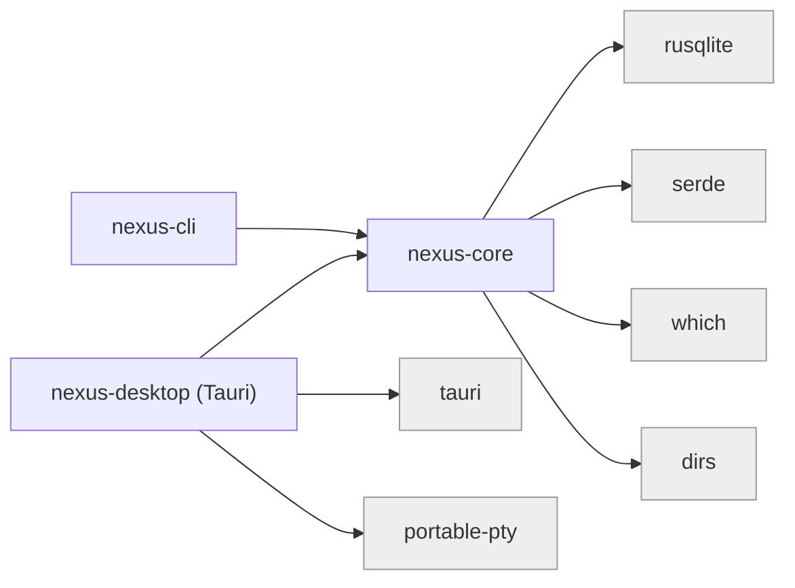
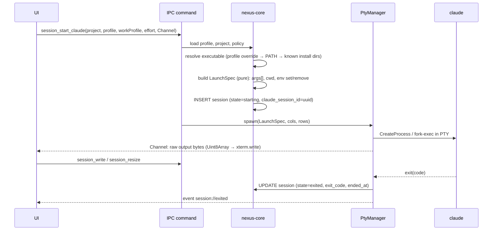

# NEXUS Architecture

Status: living document. Decisions referenced as `ADR-NNNN` live in [`docs/DECISIONS/`](DECISIONS/).

## 1. Shape of the system

NEXUS is a local-first desktop application that **orchestrates** Claude Code; it does not reimplement it.
Claude Code keeps its native interactive terminal experience, its own configuration directories, its own
transcripts and its own permission system. NEXUS adds what Claude Code does not have: a multi-profile,
multi-workspace, multi-project control plane with persistent engineering continuity.

```mermaid
flowchart TB
  subgraph Desktop["apps/desktop — NEXUS Desktop (Tauri 2)"]
    UI["Vue 3 UI<br/>views · stores · xterm.js terminal pool"]
    CMD["IPC command layer<br/>(input validation, DTOs)"]
    PTY["PtyManager<br/>portable-pty · ring buffers · exit watchers"]
    UI -- "invoke / Channel (raw bytes)" --> CMD
    CMD --> PTY
  end

  subgraph Core["crates/nexus-core — shared Rust library"]
    DB["db<br/>SQLite · WAL · migrations"]
    WS["workspace<br/>manifest I/O"]
    PRJ["project<br/>registry · stack detection"]
    GIT["git<br/>git CLI · porcelain v2"]
    CL["claude<br/>install discovery · profiles · policy · auth · launch spec"]
    SES["session · host · checkpoint<br/>records · host leases · reconcile · checkpoints"]
    WP["workprofile<br/>rigor definitions"]
    ENV["env<br/>child-environment hygiene"]
  end

  subgraph CLI["crates/nexus-cli — `nexus` binary"]
    CLIC["CLI commands<br/>doctor · workspaces · projects · profiles · sessions · launch"]
    MCP["`nexus mcp`<br/>stdio MCP server"]
    HOOK["`nexus hook <event>`<br/>exec-form hook handler"]
  end

  CMD --> Core
  CLIC --> Core
  MCP --> Core
  HOOK --> Core

  subgraph Claude["Claude Code (external, per profile)"]
    CC["claude (interactive, in PTY)"]
    CFG[("CLAUDE_CONFIG_DIR<br/>settings · transcripts · plugins")]
    CC --- CFG
  end

  PTY -- "spawn: args[] + scrubbed env<br/>--session-id · --append-system-prompt<br/>(Phase 2: --mcp-config · --plugin-dir · --settings)" --> CC
  CC -- "stdio MCP (Phase 2)" --> MCP
  CC -- "hooks (Phase 2)" --> HOOK

  DB[("nexus.db<br/>(machine-local, %LOCALAPPDATA%\\NEXUS)")]
  WSF[("Workspace dir (Git-friendly)<br/>nexus-workspace.json · knowledge/ · tasks/")]
  REPOS[("Project repos<br/>(independent Git repositories)")]
  Core --> DB
  WS --> WSF
  GIT --> REPOS
```

### Module dependency rules



* `nexus-core` has **no** dependency on Tauri, PTYs or any UI. Everything the CLI, MCP server and hook
  handler need lives here, so behaviour is implemented once (spec §26).
* Inside `nexus-core` the dependency direction is: `env`, `paths`, `error` → `db`, `git`, `workspace` →
  `project`, `claude` → `session`. `claude::launch` is a **pure function** (profile + project + options →
  `LaunchSpec`) so profile-aware launching is unit-testable without spawning anything.
* PTY handling lives in the desktop crate because only the desktop renders terminals. The CLI launches
  `claude` in the user's own terminal (it simply execs).
* We start with **two crates + one app**, not nine. A module graduates to its own crate only when a second
  consumer or a compile-time boundary justifies it (ADR-0001).

## 2. Data ownership (single source of truth per fact)

| Fact | Authority | NEXUS role |
| --- | --- | --- |
| Branch, commits, dirty state, remotes | Git repository | Read via `git` CLI, cache nothing durable |
| Claude settings, plugins, skills, credentials, transcripts | Claude config dir of the profile | Read-only inspection; never edits external profiles (ADR-0004) |
| Organization policy | Managed settings (machine) / server-managed settings (account) | Detected, displayed, obeyed, never overridden |
| Workspace identity + portable project registrations | `nexus-workspace.json` in the workspace dir | Read/write (atomic) |
| Portable knowledge: rules, tasks, decisions, notes, specs, workflows | Markdown files with strict frontmatter in the workspace dir; `.nexus-local/` for local-only; global documents in `<data dir>/global/` (ADR-0013/0017) | Authored by humans, NEXUS and (tasks/notes/decisions) Claude via MCP; SQLite FTS index is rebuildable |
| Always-on rule approvals (content hash per file) | SQLite | Authoritative, per machine (threat T19) |
| Machine-local bindings: project → absolute path on *this* machine | SQLite | Authoritative |
| Claude profile registrations (config dir, executable, defaults) | SQLite | Authoritative (profiles are machine-specific) |
| Session records, process records, usage samples, app settings | SQLite | Authoritative |

Rule of thumb: **if it should travel to another machine it is a file in the workspace; if it is about this
machine it is a row in SQLite; if another tool owns it NEXUS only reads it** (ADR-0005).

## 3. Runtime process model

* **NEXUS Desktop** — one process. Owns the SQLite connection used by the UI, the PTY manager and all
  child processes it starts (Claude sessions, shells; later dev servers).
* **Claude sessions** — each is a child process attached to a PTY (ConPTY on Windows). Launched directly
  (no shell string), with an explicit argument vector and a scrubbed environment (ADR-0003).
* **`nexus` CLI** — `nexus launch` runs Claude in the user's own terminal and is a *session host* like the desktop
  (ADR-0014): it registers in `session_hosts`, keeps a 15 s lease, and its sessions become `interrupted` if it dies.
* **`nexus mcp`** — started by Claude from the per-session `--mcp-config`; bound to one NEXUS session; opens the same
  SQLite file (WAL, busy timeout). The desktop notices commits from these processes by polling `PRAGMA data_version`
  (a few-byte read) instead of running a network endpoint (ADR-0009).
* **Notifications** (ADR-0025) — every process writes typed events into the `notifications` table through
  `notify::publish` (hooks, MCP, CLI, desktop). Only the desktop shows them: a poller thread (750 ms) decides each
  pending row once against preferences and focus, shows it through the platform notifier (WinRT toast with click
  routing on Windows; Tauri's notification plugin elsewhere; a recording adapter in E2E builds) and emits
  `nexus://notifications` when the set changed. A toast click emits `nexus://notification-activated`; the UI
  resolves the target (`notification_target`) and switches workspace / opens the terminal.
* **Workflow runner** (ADR-0029) — a desktop thread (1.2 s) claims steps waiting for verification, runs their gates
  outside the database lock as this host, records results and moves runs on; `nexus workflow verify` does the same in
  a terminal. Claude (through MCP) only reports; it never runs gates.
* NEXUS exposes **no TCP/HTTP listener**. There is nothing to authenticate against on localhost. Installed builds
  register the `nexus://notification/<id>` protocol for notification clicks (focus + open only, T36).

## 4. Claude session launch pipeline



`LaunchSpec` for a profile with an explicit config dir:

```text
program  = <resolved claude executable>
args     = [--session-id <uuid>] | [--resume <uuid>]
           [-n <title>] [--effort <level>] [--model <m>]
           [--append-system-prompt <work-profile fragment>]
           <profile.extra_args…>
cwd      = project local path
env.set  = CLAUDE_CONFIG_DIR=<dir>, NEXUS_SESSION_ID, NEXUS_WORKSPACE_ID, NEXUS_PROJECT_ID, TERM, COLORTERM
env.del  = CLAUDECODE, CLAUDE_CODE_* session vars, CLAUDE_PID, CLAUDE_EFFORT, ANTHROPIC_* (unless profile opts in),
           CLAUDE_CONFIG_DIR (for the *default-location* profile)
```

The **default-location profile** (`~/.claude` + `~/.claude.json`) is launched with `CLAUDE_CONFIG_DIR`
**removed**, never set to `~/.claude`: setting it would move the global state file to
`~/.claude/.claude.json` and silently lose MCP servers, project trust and onboarding state (verified
on this machine; see `docs/RESEARCH.md`).

## 5. Terminal data path

* `portable-pty` reader thread → 64 KiB reads → `tauri::ipc::Channel` raw byte messages → `xterm.write(Uint8Array)`.
  xterm decodes UTF-8 across chunk boundaries, so Rust never splits multibyte sequences.
* Every live PTY keeps a bounded **ring buffer** (default 512 KiB) so a webview reload, view switch or HMR can
  re-attach and replay recent output.
* Input: `term.onData` → `session_write`. Resize: fit addon → `session_resize` (debounced).
* xterm instances live in a terminal pool outside the routed views, so switching views never destroys a
  running Claude TUI.

## 6. Storage layout

```text
<data dir>                          Windows: %LOCALAPPDATA%\NEXUS   macOS: ~/Library/Application Support/NEXUS
├── nexus.db (+ -wal, -shm)         Linux: $XDG_DATA_HOME/NEXUS     override: NEXUS_DATA_DIR
├── logs/                           (rotating, secrets never logged)
├── global/                         global knowledge for every workspace on this machine (constitutions)
│   └── rules/ workflows/ knowledge/
└── sessions/<nexus-session-id>/    per-session generated artifacts (mcp.json, settings.json)

<workspace dir>                     chosen by the user, optionally a Git repo (schema 2, ADR-0036)
├── nexus-workspace.json            schemaVersion, id, name, createdWith, minNexusVersion, template, features,
│                                   layout.projects, projects[] (portable fields only)
├── nexus.lock.json                 installed template components: version + original hash (ADR-0037)
├── README.md
├── .gitignore                      ignores projects/, repos/, .nexus-local/ so clones never enter the repository
├── projects/                       default location for cloned project repos (schema 1: repos/)
├── constitutions/                  constitution documents (scope in the frontmatter: global, stacks, project)
├── rules/                          rules: workspace, stack (`stacks:`) and project (`project:`) scoped
├── workflows/                      workflow documents
├── knowledge/                      decisions/, notes/ (durable memory), specs/
├── tasks/                          one Markdown file per task (frontmatter + body); file name = UUIDv7 id
├── project-context/<project>/      portable project knowledge: project.json, environment.json, overview,
│                                   architecture, current state, tasks/, decisions/, memory/, development/
├── skills/<name>/SKILL.md          workspace skills (native Claude format; delivered as the workspace AI Kit)
├── integrations/                   integration manifests (descriptive, never installed automatically)
└── .nexus-local/                   same layout, privacy: local-only, git-ignored, never synced
```

A workspace from a newer NEXUS (schema or `minNexusVersion`) opens read-only; schema 1 workspaces keep working and
are migrated only after an explained plan, with a backup (`<data dir>/workspace-backups/`).

## 7. SQLite schema (v1)

```sql
workspaces(id PK, name, description, root_path UNIQUE, created_at, last_opened_at, archived_at)
claude_profiles(id PK, name UNIQUE, description, color, config_dir NULL /*NULL = default location*/,
                executable NULL, extra_args_json, managed_by_nexus, default_work_profile, default_effort,
                default_model, created_at, updated_at, last_used_at, archived_at)
projects(id PK /*same id as manifest*/, workspace_id FK, name, local_path, remote_url, stack_json,
         created_at, last_opened_at)
session_hosts(id PK, kind CHECK(desktop|cli|service), pid, version, started_at, heartbeat_at, stopped_at)  -- v2
session_events(id PK, session_id FK, kind, summary, data JSON, source, created_at)                  -- v3, rebuilt v4
-- v4 session counters: turns, prompts, subagents, last_activity_at, attention, end_reason, transcript_path
sessions(id PK, kind CHECK(claude|shell), host, host_id FK, integrations JSON, workspace_id, project_id NULL, profile_id NULL,
         claude_session_id NULL, title, cwd, branch, work_profile, effort, model, program, pid,
         state CHECK(starting|running|exited|interrupted|failed), exit_code, error,
         resumed_from NULL, started_at, ended_at, archived_at)
app_settings(key PK, value_json)
knowledge_items(path PK, workspace_id NULL /*NULL = global*/, id, kind, title, status, project_id, priority,
                stacks, applies, privacy, updated, content_hash, size, mtime_ms, valid, error, conflict)      -- v5
knowledge_fts(path, title, body)  /* FTS5 */                                                          -- v5
knowledge_approvals(path PK, content_hash, approved_at)                                               -- v5
-- v6: sessions.task_id (session launched for a task, ADR-0018); knowledge_items.branch, commit_sha (branch-aware)
-- v7: claude_profiles.isolate_instructions (ADR-0020)
-- v9: kits(id, name, source_kind, location, git_ref, subdir, kind, version, content_hash, approved_hash, commit_sha, …),
--     kit_profiles(kit_id FK, profile_id FK, skills_json, agents, commands, hooks, mcp, enabled_at) (ADR-0024)
-- v8: memory_proposals(id, workspace_id, project_id, session_id FK, kind, title, body, source, branch, fingerprint, status, document_id, …) (ADR-0022)
-- v10: notifications(id, category, priority CHECK(critical|action|success|warning|info), source, title, body, workspace_id,
--      project_id, profile_id, session_id, task_id, workflow_id, target_kind, target_id, dedupe_key, occurrences, created_at,
--      updated_at, read_at, dismissed_at, snoozed_until, resolved_at, desktop_state, desktop_reason);
--      sessions.attention_kind (permission|input|idle|error), attention_at (ADR-0025)
-- v11: context_configs(project_id PK FK, strategy CHECK(minimal|balanced|deep|custom), custom, updated_at),
--      project_docs(project_id FK, path, title, content_hash, size, mtime_ms, indexed_at) (ADR-0028)
-- v12: quality_gates(id, project_id FK, name, title, program, args, timeout_secs, …), workflow_runs(id, workspace_id FK,
--      project_id, workflow_id, workflow_title, workflow_hash, definition, task_id, goal, rigor, profile_id, skills, status,
--      error, …), workflow_steps(run_id FK, step_id, position, kind, status, verification, attempts, max_attempts, report,
--      criteria_met, last_failure, updated_at), gate_results(id, project_id, run_id, step_id, gate_name, command, status,
--      exit_code, duration_ms, output_tail, host_id, started_at, ended_at) (ADR-0029)
-- v13: quality_gates.version, command_hash, approved_hash, approved_at; gate_results.gate_version, command_hash;
--      workflow_steps.blocked_on (each gate command version approved separately)
-- v14: usage_sources, usage_messages, usage_costs, usage_state, session_conversations, profile_billing;
--      sessions.session_start_chars (numbers only, ADR-0030)
-- v15: sync_history(id, workspace_id, op, status CHECK(running|ok|refused|failed|interrupted), host_id, branch, head_before,
--      head_after, commits, files, error_kind, message, started_at, ended_at) (ADR-0031)
-- v16: kits.workspace_id (one workspace kit per workspace)
-- v17: sessions.head_start, record_path, record_at (development records); sync_history.op gains `auto-sync` (rebuilt)
-- v18: push_requests(id, session_id FK, project_id FK, branch, head, reason, status CHECK(pending|pushed|declined|failed),
--      message, created_at, decided_at) (ADR-0043)
-- v19: learn_folders(project_id FK, path, added_at) — extra folders for learning sessions (ADR-0045)
-- v20: push_requests.failure_kind (rejected|auth|offline|remote-missing|timeout|other), dismissed_at (ADR-0047)
```

Timestamps are Unix milliseconds (INTEGER). Foreign keys enforced (`PRAGMA foreign_keys=ON`).
Migrations are forward-only SQL scripts applied in a transaction and tracked with `PRAGMA user_version`;
the app refuses to open a database whose version is newer than it understands (ADR-0002).

## 8. IPC surface (desktop)

All commands are `async` Tauri commands returning `Result<T, IpcError>` where `IpcError` is
`{ code, message }` (no stack traces, no secrets). Paths arriving from the UI are validated:
absolute, normalized, existing, no device/UNC namespace tricks (`\\?\`, `\\.\`).

| Area | Commands |
| --- | --- |
| App | `app_info`, `ui_preferences_get`, `ui_preferences_set`, `db_data_version`, `app_restart` |
| Backups | `backup_list`, `backup_create`, `backup_schedule_restore`, `backup_cancel_restore`, `backup_delete` (ADR-0032) |
| Workspaces | `workspace_list`, `workspace_active`, `workspace_create`, `workspace_import`, `workspace_activate`, `workspace_forget`, `workspace_migration_plan`, `workspace_migrate`, `workspace_doctor`, `workspace_restoration`, `workspace_repair_plan`, `workspace_repair` (ADR-0036) |
| Templates | `template_list`, `template_plan`, `template_apply` (ADR-0037) |
| Projects | `project_list`, `project_get`, `project_inspect_path`, `project_register`, `project_unregister`, `project_locate`, `project_refresh`, `project_git_status`, `project_checkpoints`, `project_scan`, `project_clone`, `project_clone_new`, `project_context_init`, `project_environment`, `project_history` |
| Project explorer | `project_tree`, `project_file`, `project_log`, `project_commit`, `project_commit_diff` (read-only, ADR-0040) |
| Learn | `project_learn_map`, `project_learn_start`, `project_learn_drafts`, `project_learn_decide`, `project_learn_exclude_graph`, `project_learn_graph`, `project_learn_add_folder`, `project_learn_remove_folder` (ADR-0041, ADR-0045) |
| Push requests | `push_request_open` (pending, and failed until dismissed or superseded), `push_request_review` (fetches first), `push_request_decide`, `push_request_dismiss` (ADR-0043, ADR-0047) |
| Skills | `skills_list`, `skills_read`, `skills_create`, `skills_save`, `skills_delete` (ADR-0046) |
| Claude | `claude_setup_status`, `claude_installations`, `profile_list`, `profile_detect`, `profile_register`, `profile_create`, `profile_update`, `profile_set_archived`, `profile_forget`, `profile_details`, `profile_auth_status`, `launch_options`, `nexus_tools` |
| Sessions | `session_list`, `session_get`, `session_start_claude`, `session_resume`, `session_open_shell`, `session_attach`, `session_write`, `session_resize`, `session_interrupt`, `session_terminate`, `session_release`, `session_rename`, `session_set_archived`, `session_continue_task` |
| Shell | `shell_list` |
| Knowledge | `knowledge_overview` (refresh or rebuild + health), `knowledge_read`, `knowledge_search`, `knowledge_create`, `knowledge_update_task` (status, log, checklist, expected hash), `knowledge_approve`, `knowledge_update` (edit a document, expected hash), `knowledge_task`, `project_knowledge` (open tasks + branch-relevant notes), `needs_you` (what waits for the person, workspace or project — ADR-0048) |
| Instructions | `instructions_inspect` (Claude's own instruction layers + NEXUS append, read-only) |
| Resume | `project_resume` (verified Git state, saved history, next action — ADR-0021) |
| Proposals | `knowledge_proposals` (extract + list pending), `knowledge_proposal_approve` (with edits/scope), `knowledge_proposal_reject` (ADR-0022) |
| Diagnostics | `profile_diagnostics` (ADR-0023) |
| Kits | `kit_list`, `kit_register` (local/Git), `kit_approve`, `kit_update`, `kit_remove`, `kit_enable` (selection), `kit_disable`, `kit_validate` (ADR-0024) |
| Workflows | `workflow_templates`, `workflow_list`, `workflow_get`, `workflow_create`, `workflow_save`, `workflow_save_raw`, `workflow_start`, `workflow_runs`, `workflow_run`, `workflow_review`, `workflow_cancel`, `workflow_retry`, `gates_list`, `gate_upsert`, `gate_approve`, `gate_approval_impact`, `gate_revoke`, `gate_remove`, `gate_suggest`, `gate_run` (ADR-0029) |
| Usage | `usage_report`, `usage_sessions`, `usage_scan`; event `nexus://usage` from the desktop's usage scanner thread (ADR-0030) |
| Sync | `sync_status`, `sync_fetch`, `sync_pull`, `sync_diff`, `sync_review_commit`, `sync_commit`, `sync_review_push`, `sync_push`, `sync_clone`, `sync_clone_new`, `sync_restore`, `sync_policy_get`, `sync_policy_set` (ADR-0042); event `nexus://sync`; each opens its own database connection (network operations must not hold the shared one) (ADR-0031) |
| Context | `context_get`, `context_set` (strategy, custom settings), `context_presets`, `context_analyze`, `context_docs`, `context_inspect` (project, profile for the prediction) (ADR-0028) |
| Constitutions | `constitution_list`, `constitution_get`, `constitution_create`, `constitution_save` (structure, expected hash), `constitution_save_raw`, `constitution_effective` (project, task, what-if), `constitution_search`, `constitution_history`, `constitution_version` (ADR-0027); approval via `knowledge_approve` |
| Notifications | `notifications_list` (filters), `notifications_counts`, `notifications_mark_read`, `notifications_dismiss`, `notifications_snooze`, `notifications_prefs`, `notifications_set_prefs`, `notifications_set_view` (visible terminal, time zone), `notifications_availability`, `notifications_test`, `notification_target`, `notifications_take_activation`; E2E builds only: `e2e_notifications_recorded`, `e2e_notifications_withdrawn`, `e2e_notification_activate`, `e2e_focus_state` (ADR-0025) |

Tauri capabilities grant only `core:default`, `dialog:allow-open` (folder picker) and
`opener:allow-open-path`/`allow-reveal-item-in-dir`. There is **no** generic filesystem or shell plugin:
every filesystem/process operation goes through a purpose-built, validated command.

## 9. Claude integration surfaces (by phase)

| Surface | Mechanism | Phase | Degrades when |
| --- | --- | --- | --- |
| Profile isolation | `CLAUDE_CONFIG_DIR` in child env | 1 | — |
| Session identity | NEXUS-assigned `--session-id`, `--resume` | 1 | — |
| Engineering rigor | `--append-system-prompt` (frozen per conversation by the system-prompt snapshot) | 1 | — |
| Always-on rules | approved always-on rules appended after the work profile, ≤ 1,500 chars (ADR-0017) | 3 ✅ | — |
| Lazy knowledge | MCP `get_context_index`, `search_knowledge`, `get_document`, task and memory tools; SessionStart adds a one-line count pointer | 3 ✅ | MCP blocked by policy → only always-on rules reach Claude |
| Task sessions | task brief (≤ 900 chars, no history) appended at launch; current task state at SessionStart after resume/compaction; `get_task`/`update_task` (ADR-0018) | 4 ✅ | hooks blocked → no resume line; MCP blocked → brief only |
| Instructions inspector | read-only model of Claude's CLAUDE.md/rules/import loading, verified against `InstructionsLoaded` (ADR-0019) | 4 ✅ | — |
| Profile isolation | session `--settings` `claudeMdExcludes` for the default profile's `~/.claude` files (opt-in, ADR-0020) | 4 ✅ | — (a plain setting; applies even when hooks are blocked) |
| Resume project | MCP `get_resume_summary`; SessionStart pointer names it | 3 ✅ | MCP blocked → desktop/CLI only |
| Native effort/model | `--effort`, `--model` | 1 | — |
| Live session list | `claude agents --json` reconciliation | 2 | older CLI |
| Auth status | `claude auth status --json` (per profile env) | 1 | CLI absent |
| NEXUS tools | `--mcp-config <generated file>` → `nexus mcp --session <id>` (implemented) | 2 ✅ | `disableSideloadFlags`, `allowManagedMcpServersOnly`, `strictPluginOnlyCustomization` |
| Lifecycle capture | `--settings <generated file>` exec-form hooks → `nexus hook` (implemented, additive to user hooks — verified) | 2 ✅ | `allowManagedHooksOnly`, `disableAllHooks` |
| Skills / AI Kits | `--plugin-dir <overlay>` per session for profiles the kit is enabled for; overlay holds only selected skills; hooks/MCP opt-in (ADR-0024) | 4 ✅ | `disableSideloadFlags`, `strictPluginOnlyCustomization` (kits withheld); managed MCP/hook rules drop those parts |
| Usage | OTel (personal profiles only, opt-in), transcript compat layer (labelled) | 5 | org-managed telemetry, format drift |

Core features never depend on hooks or MCP. When policy blocks a surface, NEXUS shows *why* and keeps
working (session tracking falls back to PTY exit + `claude agents --json`).

## Usage analytics and workspace sync (ADR-0030, ADR-0031)

* `nexus_core::usage` — `transcript` (locate `projects/*/<id>.jsonl` and subagent files in the profile's config dir;
  incremental typed parsing; version compatibility list), ingestion (`scan_session`, `scan_due`; attribution through
  `session_conversations`), `report` (totals, daily, groups, efficiency, coverage, sessions, telemetry notes), billing
  classification from `claude auth status`. Machine-local tables from migration 0014; nothing is synced.
* Hosts scan: the desktop's `usage-scanner` thread (8 s, a few sessions per tick) and the CLI before each `nexus usage`.
* `nexus_core::workspace_sync` — `readiness`/`status` (read-only), `inspect` (pre-commit, pre-push, incoming),
  `ops` (fetch, fast-forward pull, reviewed commit and push, clone and restore, file diffs), `history` (machine-local,
  one operation at a time, interrupted operations reconciled by hosts). Git calls in `git.rs` (no shell, no prompts,
  no external diff drivers, `ext::`/`fd::` disabled).

## Push outcomes, "Needs you" and housekeeping (ADR-0047, ADR-0048)

* `nexus_core::push_request` — `review` fetches the request's remote branch first (`git::fetch_branch`, 60 s) and
  reports ahead/behind/diverged and the incoming commits; `decide` records failures with their kind (migration 0020) and
  publishes an action notification; `open` lists pending requests and failed ones until dismissed or superseded.
* `nexus_core::inbox::needs_you` — what waits for the person in a workspace or one project, from existing records only
  (sessions' attention, push requests, workflow steps, the knowledge index, approvals, kits); IPC `needs_you`.
* `nexus_core::prune::artifacts` — at desktop start: `<data>/sessions/<id>/` of sessions ended more than 30 days ago
  (never live ones) and kit overlays of profiles that no longer exist.
* `claude::prepare` — `prepare` and `preview` share one builder for the appended text (the inspector counts what a launch
  sends).
* Desktop: `useAction` / `ActionButton` for every backend call (pending, re-entrancy guard, persistent errors); the
  project page's tabs; knowledge refresh on window focus and session end (no file-system watcher).
