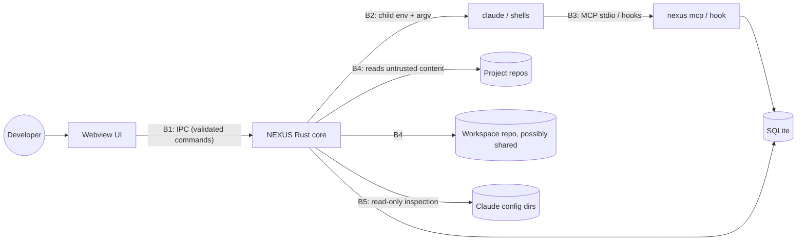

# NEXUS Threat Model

Scope: Claude profiles, workspaces, terminals and the MCP/hook integration. Method: assets → trust boundaries →
threats (STRIDE-tagged) → mitigations → verification. Reviewed at every phase gate.

## 1. Assets

| Asset | Where it lives | Why it matters |
| --- | --- | --- |
| Claude credentials (OAuth tokens, API keys) | `<config dir>/.credentials.json` (Win/Linux), macOS keychain, env vars | Account takeover, billing, cross-account confusion |
| Organisation policy & telemetry config | managed settings, `remote-settings.json` | Compliance; tampering is a policy violation |
| Proprietary source code & company AI Kits | project repos, kit directories | Confidentiality / NDA |
| Workspace knowledge (tasks, decisions, memory) | workspace dir, SQLite index | Confidentiality; integrity of instructions given to Claude |
| Git credentials | Git Credential Manager / keychain | Repo access |
| Terminal I/O | PTY streams, ring buffers | May contain secrets typed or printed |
| NEXUS DB | `%LOCALAPPDATA%\NEXUS\nexus.db` | Integrity of session/profile bindings |

## 2. Trust boundaries

* **B1 Webview → Rust.** The webview renders untrusted strings (repo names, branch names, Claude output);
  treat it as able to call any granted command with arbitrary arguments.
* **B2 NEXUS → child processes.** What we pass (argv, env, cwd) decides which account and policy apply.
* **B3 Claude → NEXUS.** Claude may be prompt-injected by repository content; its MCP calls are requests,
  not authority.
* **B4 Repositories/workspaces → NEXUS.** Cloned or synced content is attacker-controllable.
* **B5 NEXUS → Claude config dirs.** Owned by Claude Code and the organisation; NEXUS is a reader.
* The **OS user** is the outer trust boundary. NEXUS does not defend against malware running as the same user;
  it must not *widen* what such content can do or what a prompt-injected Claude can reach.

## 3. Threats and mitigations

| ID | STRIDE | Threat | Mitigation | Verified by |
| --- | --- | --- | --- | --- |
| T1 | E | Command injection through repo/branch/session names reaching a shell | No shell strings anywhere: `Command`/`CommandBuilder` with argv; only native executables launched; `.cmd` shims rejected | unit: launch spec never contains shell; test with names containing `& \| ; $( ) " '` |
| T2 | I, S | Wrong account: profile A's session uses profile B's config | `CLAUDE_CONFIG_DIR` set/removed explicitly per launch; default-location profile removes it; spec built by a pure, tested function | unit + PTY integration test with `fake-claude` echoing its env |
| T3 | I, E | Ambient credential bleed: `ANTHROPIC_API_KEY`, `CLAUDE_CODE_MESSAGING_TOKEN`, session markers inherited from NEXUS's own environment | Child-env scrub list (ADR-0003); opt-in per profile for `ANTHROPIC_*` | unit: scrub table; integration: fake-claude sees none of them |
| T4 | T | NEXUS modifies a personal/company Claude config (or org policy) | External profiles are read-only (`managed_by_nexus=false`); injection is session-scoped flags only; policy keys read, never written | code review rule + test that inspection opens files read-only and writes nothing (dir mtime/listing unchanged) |
| T5 | E | Untrusted repo runs code during NEXUS import (hooks in `.claude/settings.json`, `core.fsmonitor`, npm scripts) | Import is deterministic file inspection only; never `claude -p` (skips trust dialog) in an untrusted repo; `git -c core.fsmonitor=false`, `GIT_OPTIONAL_LOCKS=0`; NEXUS never runs package scripts without explicit action | unit: git args; fixture repo with malicious fsmonitor → status runs, marker file not created |
| T6 | E | Synced workspace (git pull) changes a process/workflow command → code execution | Commands from workspace files are hash-pinned to an explicit local approval in SQLite; changed hash ⇒ re-approval dialog showing the diff (Phase 4–5) | unit on approval store; e2e dialog |
| T7 | I | Cross-workspace leakage via MCP (Claude in work session reads personal workspace memory) | MCP scope bound at launch (`--session <id>` in the per-session config); every query filtered by the session's workspace; references resolve only among that workspace's projects | `mcp::tests::other_workspaces_are_invisible` (by id, name and id prefix), `unbound_server_refuses_every_tool`, CLI `mcp_knowledge_is_scoped_to_the_sessions_workspace` |
| T8 | I | Company data pushed to a personal remote | Workspaces are separate dirs/repos; `repos/` gitignored; sync shows the outgoing diff and remote before push; never auto-push; per-workspace privacy flag "never sync" | unit: generated `.gitignore`; sync UI review (Phase 6) |
| T9 | E | Prompt-injected Claude uses MCP to run commands | No exec, file or network tool; writes are a bounded checkpoint on the bound session and knowledge records of kind task/note/decision created through the validated store (no path input, ids are UUIDs, secrets refused, `source: claude`); Claude cannot create rules, workflows or global documents | `invalid_input_is_rejected_*`, tool-list test, `knowledge_tools_are_lazy_bounded_and_workspace_scoped` |
| T10 | T | Path traversal / device paths via IPC (`..`, `\\?\`, `\\.\pipe`, UNC) | `validate_user_path`: absolute, no NUL, no device namespace, canonicalized, must exist and be a directory where required | unit: hostile path table |
| T11 | I | Secrets in logs/UI (auth status email, policy headers, terminal output) | Never log env values, auth payloads or terminal bytes; policy parser extracts allowlisted keys only; auth email kept in memory only | unit: policy parser ignores unknown keys; log review |
| T12 | D | Runaway output / huge files (multi-GB `package.json`, binary spam) | File reads size-capped (1 MiB); ring buffer bounded; channel chunks capped | unit |
| T13 | T | Old NEXUS build corrupts newer DB | Refuse DB with newer `user_version`; backup before migrating | unit |
| T14 | S | Malicious AI Kit metadata (path escape in manifest, hooks running on load) | Kits are previewed (component inventory via `claude plugin details`/validate) before association; paths confined to kit root; no NEXUS-side execution of kit content (Phase 5) | fixtures with `../` paths |
| T15 | E | Webview compromise (XSS from rendered repo content) escalates via IPC | Vue text interpolation only (no `v-html` on untrusted data); strict CSP (`script-src 'self'`); minimal Tauri capabilities (no fs/shell plugins). Tauri `freezePrototype` is **off**: xterm.js assigns `toString` on objects, which throws under a frozen `Object.prototype` (the JS "override mistake") | lint rule + CSP check in tests |
| T16 | R | Killing the wrong process (PID reuse, name matching) | Only PTY children NEXUS spawned, by handle — never by PID lookup or name; external processes are read-only | code review |
| T18 | E | WebView2 honours `WEBVIEW2_ADDITIONAL_BROWSER_ARGUMENTS` in any build: a remote-debugging port would let another local user drive NEXUS IPC | Production builds remove all webview override variables before any webview exists and refuse to start if a WebView2 policy enables debugging; test support only via the `e2e-webview-debugging` feature (ADR-0015) | `webview_guard` unit tests; `e2e/t18-check.mjs` (production build passes, test build fails as control) in CI |
| T19 | T, E | Prompt injection through synced knowledge: a collaborator or compromised remote adds/edits an always-on rule that becomes system prompt | Only approved versions (content hash per machine) of always-on workspace rules are delivered; edits withdraw approval; the file is re-read and re-hashed right before launch; budget of 1,500 chars; the desktop shows the full text before "Approve this version"; on-demand content is delivered only as tool output (ADR-0017) | `context::tests::always_rules_need_approval_*`, CLI `always_on_rules_reach_launches_by_hierarchy_and_only_once_approved`, desktop E2E approval checks |
| T20 | I | Knowledge files leak secrets or machine details through sync | Credential patterns refused anywhere and absolute paths refused in frontmatter on every write; existing matching files reported invalid; `local-only` records live in git-ignored `.nexus-local/` (ignore rule written before the first local record) | `knowledge::tests` secret/path cases, CLI round-trip test |
| T17 | I | Terminal escape sequences abusing the renderer (OSC 52 clipboard write, hyperlinks to `file:`) | xterm defaults (no OSC 52 clipboard write); web-links addon opens only `http(s)` URLs via the opener with confirmation for non-https | unit on link handler |

## 4. Organisation-managed profiles

* NEXUS reads, never writes, managed policy. Machine-wide managed settings apply to *all* profiles; NEXUS states
  this in the profile UI.
* When policy blocks a NEXUS surface (sideload flags, hooks, MCP), NEXUS omits it and shows the reason. It never
  tries alternative routes (e.g. writing hooks into user settings) to get around a policy.
* Organisation telemetry (`OTEL_*` from managed settings) is never redirected, duplicated or disabled.

## 5. Residual risks (accepted, documented)

* Same-user malware can read the DB, transcripts and credential files — outside NEXUS's control.
* Claude Code itself executes tools; NEXUS relies on Claude's permission system and never adds
  `--dangerously-skip-permissions`.
* Unsigned development builds trigger OS warnings; signed releases are a Phase 6 decision.
