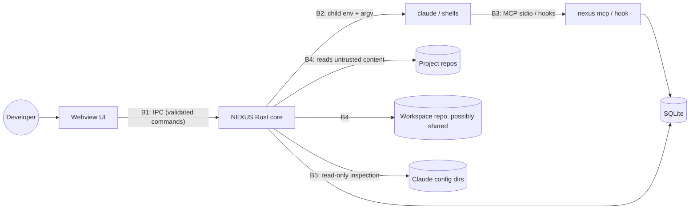

# NEXUS Threat Model

Scope: Claude profiles, workspaces, terminals and the MCP/hook integration. Method: assets → trust boundaries →
threats (STRIDE-tagged) → mitigations → verification. Reviewed at every phase gate.

## 1. Assets

| Asset | Where it lives | Why it matters |
| --- | --- | --- |
| Claude credentials (OAuth tokens, API keys) | `<config dir>/.credentials.json` (Win/Linux), macOS keychain, env vars | Account takeover, billing, cross-account confusion |
| Organisation policy & telemetry config | managed settings, `remote-settings.json` | Compliance; tampering is a policy violation |
| Proprietary source code & company AI Kits | project repos, kit directories | Confidentiality / NDA |
| Workspace knowledge (tasks, decisions, memory) | workspace dir, SQLite index | Confidentiality; integrity of instructions given to Claude |
| Git credentials | Git Credential Manager / keychain | Repo access |
| Terminal I/O | PTY streams, ring buffers | May contain secrets typed or printed |
| NEXUS DB | `%LOCALAPPDATA%\NEXUS\nexus.db` | Integrity of session/profile bindings |

## 2. Trust boundaries

* **B1 Webview → Rust.** The webview renders untrusted strings (repo names, branch names, Claude output);
  treat it as able to call any granted command with arbitrary arguments.
* **B2 NEXUS → child processes.** What we pass (argv, env, cwd) decides which account and policy apply.
* **B3 Claude → NEXUS.** Claude may be prompt-injected by repository content; its MCP calls are requests,
  not authority.
* **B4 Repositories/workspaces → NEXUS.** Cloned or synced content is attacker-controllable.
* **B5 NEXUS → Claude config dirs.** Owned by Claude Code and the organisation; NEXUS is a reader.
* The **OS user** is the outer trust boundary. NEXUS does not defend against malware running as the same user;
  it must not *widen* what such content can do or what a prompt-injected Claude can reach.

## 3. Threats and mitigations

| ID | STRIDE | Threat | Mitigation | Verified by |
| --- | --- | --- | --- | --- |
| T1 | E | Command injection through repo/branch/session names reaching a shell | No shell strings anywhere: `Command`/`CommandBuilder` with argv; only native executables launched; `.cmd` shims rejected | unit: launch spec never contains shell; test with names containing `& \| ; $( ) " '` |
| T2 | I, S | Wrong account: profile A's session uses profile B's config | `CLAUDE_CONFIG_DIR` set/removed explicitly per launch; default-location profile removes it; spec built by a pure, tested function | unit + PTY integration test with `fake-claude` echoing its env |
| T3 | I, E | Ambient credential bleed: `ANTHROPIC_API_KEY`, `CLAUDE_CODE_MESSAGING_TOKEN`, session markers inherited from NEXUS's own environment | Child-env scrub list (ADR-0003); opt-in per profile for `ANTHROPIC_*` | unit: scrub table; integration: fake-claude sees none of them |
| T4 | T | NEXUS modifies a personal/company Claude config (or org policy) | External profiles are read-only (`managed_by_nexus=false`); injection is session-scoped flags only; policy keys read, never written | code review rule + test that inspection opens files read-only and writes nothing (dir mtime/listing unchanged) |
| T5 | E | Untrusted repo runs code during NEXUS import (hooks in `.claude/settings.json`, `core.fsmonitor`, npm scripts) | Import is deterministic file inspection only; never `claude -p` (skips trust dialog) in an untrusted repo; `git -c core.fsmonitor=false`, `GIT_OPTIONAL_LOCKS=0`; NEXUS never runs package scripts without explicit action | unit: git args; fixture repo with malicious fsmonitor → status runs, marker file not created |
| T6 | E | Synced workspace (git pull) changes a process/workflow command → code execution | Commands from workspace files are hash-pinned to an explicit local approval in SQLite; changed hash ⇒ re-approval dialog showing the diff (Phase 4–5) | unit on approval store; e2e dialog |
| T7 | I | Cross-workspace leakage via MCP (Claude in work session reads personal workspace memory) | MCP scope bound at launch (`--session <id>` in the per-session config); every query filtered by the session's workspace; references resolve only among that workspace's projects | `mcp::tests::other_workspaces_are_invisible` (by id, name and id prefix), `unbound_server_refuses_every_tool`, CLI `mcp_knowledge_is_scoped_to_the_sessions_workspace` |
| T8 | I | Company data pushed to a personal remote | Workspaces are separate dirs/repos; `repos/` gitignored; sync shows the outgoing diff and remote before push; never auto-push; per-workspace privacy flag "never sync" | unit: generated `.gitignore`; sync UI review (Phase 6) |
| T9 | E | Prompt-injected Claude uses MCP to run commands | No exec, file or network tool; writes are a bounded checkpoint on the bound session and knowledge records of kind task/note/decision created through the validated store (no path input, ids are UUIDs, secrets refused, `source: claude`); Claude cannot create rules, workflows or global documents; task updates are limited to status, a bounded log line, checklist ticks and the current branch/commit read from Git | `invalid_input_is_rejected_*`, tool-list test, `knowledge_tools_are_lazy_bounded_and_workspace_scoped`, CLI task-flow test |
| T10 | T | Path traversal / device paths via IPC (`..`, `\\?\`, `\\.\pipe`, UNC) | `validate_user_path`: absolute, no NUL, no device namespace, canonicalized, must exist and be a directory where required | unit: hostile path table |
| T11 | I | Secrets in logs/UI (auth status email, policy headers, terminal output) | Never log env values, auth payloads or terminal bytes; policy parser extracts allowlisted keys only; auth email kept in memory only | unit: policy parser ignores unknown keys; log review |
| T12 | D | Runaway output / huge files (multi-GB `package.json`, binary spam) | File reads size-capped (1 MiB); ring buffer bounded; channel chunks capped | unit |
| T13 | T | Old NEXUS build corrupts newer DB | Refuse DB with newer `user_version`; backup before migrating | unit |
| T14 | S, E | Malicious AI Kit (hooks/MCP servers that run code, manifest paths escaping the kit, symlinks, content swapped after review) | Inventory shown before use; content hash approved by a person, any change withdraws it; **hooks and MCP servers off unless enabled per profile** (UI warning); manifest paths outside the kit refused, symlinks never followed; overlay contains only selected parts; Claude's own validator on demand; NEXUS never executes kit content itself (ADR-0024) | `plugin::tests`, `kits::tests`, CLI `kits_reach_only_the_profiles_they_are_enabled_for`, `e2e/kits-real-claude.mjs` |
| T15 | E | Webview compromise (XSS from rendered repo content) escalates via IPC | Vue text interpolation only (no `v-html` on untrusted data); strict CSP (`script-src 'self'`); minimal Tauri capabilities (no fs/shell plugins). Tauri `freezePrototype` is **off**: xterm.js assigns `toString` on objects, which throws under a frozen `Object.prototype` (the JS "override mistake") | lint rule + CSP check in tests |
| T16 | R | Killing the wrong process (PID reuse, name matching) | Only PTY children NEXUS spawned, by handle — never by PID lookup or name; external processes are read-only | code review |
| T18 | E | WebView2 honours `WEBVIEW2_ADDITIONAL_BROWSER_ARGUMENTS` in any build: a remote-debugging port would let another local user drive NEXUS IPC | Production builds remove all webview override variables before any webview exists and refuse to start if a WebView2 policy enables debugging; test support only via the `e2e-webview-debugging` feature (ADR-0015) | `webview_guard` unit tests; `e2e/t18-check.mjs` (production build passes, test build fails as control) in CI |
| T19 | T, E | Prompt injection through synced knowledge: a collaborator or compromised remote adds/edits an always-on rule that becomes system prompt | Only approved versions (content hash per machine) of always-on workspace rules are delivered; edits withdraw approval; the file is re-read and re-hashed right before launch; budget of 1,500 chars; the desktop shows the full text before "Approve this version"; on-demand content is delivered only as tool output (ADR-0017) | `context::tests::always_rules_need_approval_*`, CLI `always_on_rules_reach_launches_by_hierarchy_and_only_once_approved`, desktop E2E approval checks |
| T20 | I | Knowledge files leak secrets or machine details through sync | Credential patterns refused anywhere and absolute paths refused in frontmatter on every write; existing matching files reported invalid; `local-only` records live in git-ignored `.nexus-local/` (ignore rule written before the first local record) | `knowledge::tests` secret/path cases, CLI round-trip test |
| T21 | I | Cross-profile instruction bleed: the default profile's `~/.claude/CLAUDE.md` and `~/.claude/rules/` load as project memory in *other* profiles' sessions for projects inside the home folder (Claude behaviour, verified) — e.g. personal instructions in a company session | Not caused by NEXUS and never changed silently: the inspector flags each such file (ADR-0019); opt-in per-profile **instruction isolation** adds exact `claudeMdExcludes` for those files to the session-scoped `--settings` only — no Claude config is modified, managed instructions cannot be excluded and managed exclusions still merge in (ADR-0020); when it happens anyway, NEXUS's InstructionsLoaded hook sees it live and raises a warning notification (ADR-0028) | `isolation::tests`, CLI `profile_isolation_excludes_default_profile_instructions_through_session_settings`, `e2e/security-real-claude.mjs` (control + isolated run, inspector exact) |
| T22 | T, E | Prompt injection through a synced task (title, description, checklist written by someone else) | Task text never enters the system prompt — only a NEXUS-authored pointer with the validated id; the text arrives as one bounded `<nexus-task-data>` block in SessionStart context with every field escaped (one line, no control characters, `<`/`>` neutralised) and labelled untrusted; Claude's session name is `NEXUS task <id>`; tool output carries a data note (ADR-0020) | `tasks::tests::injected_instructions_in_task_text_stay_inert_data`, CLI `instructions_planted_in_a_task_never_reach_the_system_prompt`, `e2e/security-real-claude.mjs` |
| T23 | T | Memory poisoning: a prompt-injected or mistaken Claude records "decisions" that end up as authoritative, synced knowledge | Checkpoints only become *proposals* (machine-local SQLite, invisible to knowledge tools and other machines); a person reviews, edits and approves each one; approval goes through the validated store (secrets refused); provenance recorded; rejected proposals are never re-proposed; Claude has no approval tool (ADR-0022) | `proposals::tests`, CLI `session_end_proposes_memories_and_only_approval_makes_knowledge`, desktop E2E |
| T24 | I | Secrets exposed by profile diagnostics (API keys in settings `env`, `apiKeyHelper`, MCP args/env/headers in `.claude.json`, credentials) | Allowlisted extraction: values only for non-sensitive keys; env/header *names* only; programs by file name, URLs by host; `.credentials.json` never opened; only `mcpServers` read from `.claude.json` (ADR-0023) | `diagnostics::tests::explains_the_configuration_and_never_exposes_secrets`, CLI diagnostics test, real-CLI test (planted secrets) |
| T25 | I | Cross-profile leakage of kits (company skills/MCP in personal sessions or vice versa) | Kits are never installed into a profile; NEXUS passes `--plugin-dir` only for profiles the kit is enabled for; same-name kits refused per profile | CLI + desktop E2E; real-CLI init-event check for Work vs Personal |
| T26 | E | Git-backed kit registration abused for command execution (`ext::` transports, option injection) | Only https/ssh/scp-like/file URLs; `protocol.ext/fd.allow=never`; `--` before the URL; shallow, single-branch, no submodules; NEXUS-owned checkout only | `kits::tests::marketplace_sources_need_a_plugin_choice_and_git_urls_are_restricted`, CLI git-kit test |
| T27 | S, T | Attention spoofing: a session (or a process reusing its settings file) raises or clears attention for another session, profile or workspace | Identity only from the NEXUS session row, never from the payload; hook payloads naming another Claude conversation are ignored; MCP `request_attention` has no session argument (bound to its server's session); the desktop decides delivery itself (ADR-0025) | `attention::tests::foreign_conversations_and_sessions_without_hooks`, CLI attention test, `e2e/attention.mjs` (identity per workspace/profile) |
| T28 | I | Disclosure through notifications (OS notification center, lock screen, screen sharing) | Only short, escaped summaries: tool *names*, fixed texts, allowlisted error codes, ≤ 200-char MCP messages; never prompts, tool input, questions or model output; per-category/workspace/profile desktop opt-out, quiet hours; lock-screen content policy (generic text while locked by default, or always) and withdrawal of handled toasts from the Action Center | `attention::tests` (no tool input, question text or last message stored), CLI + E2E "s3cr3t" checks |
| T29 | D | Notification flooding by a looping session or MCP tool | Dedupe window (×n, no re-delivery), ≤ 8 per session per minute, ≤ 3 MCP requests per session per 10 min, retention 30 days | `notify::tests::publish_dedupes_rate_limits_and_resolves`, CLI rate-limit check |
| T30 | E | NEXUS answers or approves on the user's behalf (hook decisions, keystrokes) | Attention hooks print nothing and exit 0; no `--permission-prompt-tool`; no PTY writes from notifications; MCP tool text says NEXUS never answers | hook output assertions in CLI and desktop E2E |
| T31 | T, E | A synced constitution (or a project file) weakens team policy — disables or overrides a mandatory rule, or changes rule text | Versions changed outside NEXUS are withheld until approved (per content hash, as T19) and raise a review notification; narrower scopes can never override or disable a mandatory policy (conflict, policy stays); rule text reaches Claude escaped, one line per rule, never the raw markup; managed Claude policy is outside NEXUS and always wins (ADR-0027) | `constitution::tests`, CLI constitution test, `e2e/constitutions.mjs` |
| T32 | I | Project-docs retrieval hands Claude secrets or arbitrary files | Allowlisted Markdown only (README, conventional docs folders), size/count limits, no symlinks, files with credential markers skipped; `get_document { path }` reads only indexed docs and resolves within the project; queries are not stored (ADR-0028) | `context::docs::tests`, CLI context test (`../` refused) |
| T33 | E | A synced workflow (or a changed one) runs commands on every machine that opens the workspace; a gate command is changed (by another local tool editing the database, or by mistake) and then runs unseen | Workflow files name gates only; gate commands are machine-local, defined by the person (desktop/CLI — never MCP or a file), argument vectors without a shell; changed workflow versions need approval before they run; **each gate command version needs its own explicit approval** (hash of program + args pinned at approval, version bump on change, checked against the recomputed hash in the one execution choke point `gates::begin`) — distinct from workflow approval (ADR-0029 amendment) | `workflow::tests` (gate names validated), `gates::tests` (unapproved / changed / forged refused), `run::tests::gate_commands_run_only_in_their_approved_version`, CLI workflow test, desktop E2E |
| T34 | I | Gate output exposes secrets (test logs printing tokens) | Only the last 8 KiB are kept, credential-like tokens are redacted, results stay machine-local and are shown to the user; Claude sees at most 1,500 characters of a failure through its own run | `gates::tests` redaction case |
| T35 | T | AI-reported completion is mistaken for verification (a step "passes" because Claude says so) | Every passed step records how it is known (`ai-reported` / `verified` / `human` / `skipped`) and the UI, CLI and task log show it; gates run in a NEXUS host, never via MCP; check steps cannot be reported by Claude; at critical rigor unverified steps need a person | `run::tests`, CLI + desktop E2E (badges, refused check-step report) |
| T36 | S, T | The `nexus://` protocol (installed builds) is abused by a web page or another program | The handler accepts only `nexus://notification/<uuid>`, only focuses NEXUS and opens that notification's target (read-only navigation, unknown ids ignored); no parameters, no side effects | `notifier::tests::protocol_activation_accepts_only_notification_uuids`, attention E2E |
| T37 | I | Usage analytics reads Claude's transcripts, which contain prompts, code, tool output and possibly secrets of company projects | Read-only, bounded (8 MiB per scan, line and file limits), only regular files under the profile's `projects/` for a UUID conversation id; a typed parser keeps message id, model, timestamp and token counts — no text is stored or logged; errors report the kind, never a path's contents; usage stays machine-local and is never synced (ADR-0030) | `usage::tests` (no text stored), CLI usage test (database bytes, transcript unchanged), `e2e/usage.mjs`, `e2e/usage-real-claude.mjs` |
| T38 | T | Usage figures mislead: a guess shown as fact, a subscription shown as spend, a changed transcript format read silently wrong, organisation telemetry altered to collect numbers | Every figure carries provenance (parsed / estimate / unavailable, ADR-0010); unknown values say why instead of 0; cost only for API-billed profiles (subscription usage is never converted into spend); the Claude Code version of each transcript is checked against verified formats and flagged otherwise; NEXUS never sets or forwards telemetry variables | `usage::tests` (billing, unverified, unavailable), CLI usage test, vitest, `e2e/usage.mjs` (ambient telemetry not forwarded) |
| T39 | I, T | Workspace sync leaks machine-local or secret files (databases, `.env`, keys, local-only knowledge, the NEXUS data folder, credentials in text) or publishes unreviewed content | Commits and pushes only after a review the person confirmed (a token over exactly the reviewed state); a pre-commit and pre-push inspection blocks credentials in added lines, sensitive files by name, local-only knowledge, machine-local Claude configuration, `repos/`, symlinks, non-portable paths and huge files, warns about machine paths; never automatic, never forced; machine-local state (SQLite) lives outside the workspace and is never staged (ADR-0031) | `workspace_sync::tests`, `inspect::tests`, CLI sync test, `e2e/sync.mjs` |
| T40 | T, E | A teammate's (or attacker's) commit plants content that activates behaviour or escapes the folder: changed rules, constitutions, workflows or AI Kits, symbolic links out of the workspace, Windows device names, executable transports | Pulls fast-forward only after an incoming inspection (symlinks, `..`, device names block); changed rules/constitutions/workflows need approval per machine (content hash), changed kit folders lose their approval; gate commands are machine-local and approved per version (a pull cannot add one); `ext::`/`fd::` transports are disabled; external diff and text-conversion drivers never run | `workspace_sync::tests` (unsafe incoming, approvals after pull), `e2e/sync.mjs` |
| T41 | S, I | Credentials for the remote are captured, stored or shown by NEXUS | NEXUS never asks for credentials: Git runs without terminal prompts (`GIT_TERMINAL_PROMPT=0`, `GCM_INTERACTIVE=never`) and the person's credential helper authenticates; failures are classified as authentication errors with URLs redacted; remote URLs are shown without user info | `git::tests::remote_errors_are_classified_and_redacted`, core sync tests |
| T42 | D | User data is lost on an upgrade, a failed migration, a damaged file, an uninstall or a restore | Backup before every upgrade, daily automatic backups, a pre-restore backup; migrations in transactions and never treated as corruption; foreign SQLite files refused untouched; damaged files moved aside, never deleted, with the newest backup offered; restore verifies (checksum, schema, `quick_check`) and puts the previous files back on failure; installer keeps programs (`%LOCALAPPDATA%\Programs\NEXUS`) apart from data (`%LOCALAPPDATA%\NEXUS`) and uninstall never touches the data (ADR-0032/0033) | `db::tests`, `db::backup::tests`, `e2e/installed.mjs` (data survives uninstall) |
| T44 | E, I | A synced workspace file makes NEXUS run a program (integration or environment manifest naming a binary), or project setup runs repository code without the person seeing it | Workspace files name tools only by id from `toolchain::TOOLS`; NEXUS only asks known tools for their version; install and setup commands are never executed — they are typed into a visible terminal for the person to run; environment files are read for variable **names** only and `.env` is never read (Portable Workspace P5) | `toolchain::tests`, `project::environment::tests`, `workspace_doctor::tests`, `e2e/portable.mjs` |
| T45 | I | Automatic synchronisation publishes something the person did not review (private knowledge, unapproved memories, credentials, someone else's commits) or to the wrong place | Policy machine-local, manual by default; trusted mode needs an explicit private-remote confirmation, publishes only the allowlist of NEXUS-generated records through M29's inspected commit and push, and stops on any finding, a changed remote/branch, a remote that is ahead or outgoing commits outside the allowlist; never forced; managed `policy.json` can forbid it; every run audited (ADR-0039) | `workspace_sync::tests` (policies), `e2e/portable.mjs` |
| T46 | I | An independent project repository (a client's code, its history) or another nested repository is committed into the workspace repository, as a gitlink or as files, and reaches the workspace remote | Clone folders `projects/` and `repos/` are ignored; a project registered elsewhere inside the workspace is added to `.gitignore` at registration; the outgoing inspection treats an untracked folder with `.git` as a gitlink and blocks the commit review on any gitlink; the Workspace Doctor reports `projects-ignored` with a reviewable repair (P9); a folder or repository with other content (a project) is never turned into a workspace — creating one is allowed only in a new or empty folder or an empty repository (ADR-0036 amendment) | `workspace_sync::tests::generated_layout_and_independent_repositories_never_enter_the_workspace_repository`, `host_scaffolding_is_kept_and_a_project_repository_never_becomes_a_workspace`, `e2e/workspace-setup.mjs` |
| T43 | T, E | A release artifact carries test-only capabilities (WebView2 debugging), bundled configuration or secrets, or is tampered with in transit | `compile_error!` for the e2e feature outside debug builds; T18 against the release program; the installer bundles only the desktop program, the CLI and the uninstaller (checked after a real install); the embedded frontend is checked for source maps, credentials and machine paths; SHA256SUMS and build-provenance attestations; draft releases only; signing pending (ADR-0033) | `scripts/release-check.mjs`, `e2e/installed.mjs`, `e2e/t18-check.mjs` |
| T17 | I | Terminal escape sequences abusing the renderer (OSC 52 clipboard write, hyperlinks to `file:`) | xterm defaults (no OSC 52 clipboard write); web-links addon opens only `http(s)` URLs via the opener with confirmation for non-https | unit on link handler |

## 4. Organisation-managed profiles

* NEXUS reads, never writes, managed policy. Machine-wide managed settings apply to *all* profiles; NEXUS states
  this in the profile UI.
* When policy blocks a NEXUS surface (sideload flags, hooks, MCP), NEXUS omits it and shows the reason. It never
  tries alternative routes (e.g. writing hooks into user settings) to get around a policy.
* Organisation telemetry (`OTEL_*` from managed settings) is never redirected, duplicated or disabled.

## 5. Residual risks (accepted, documented)

* Same-user malware can read the DB, transcripts and credential files — outside NEXUS's control.
* Claude Code itself executes tools; NEXUS relies on Claude's permission system and never adds
  `--dangerously-skip-permissions`.
* Unsigned development builds trigger OS warnings; signed releases are a Phase 6 decision.
